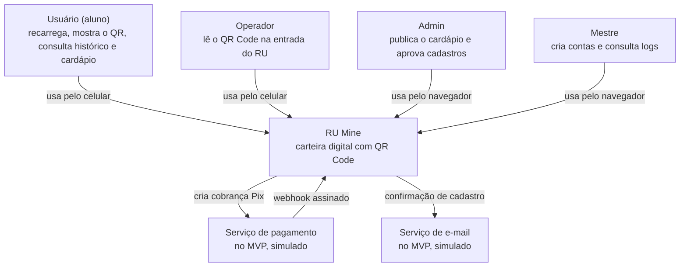
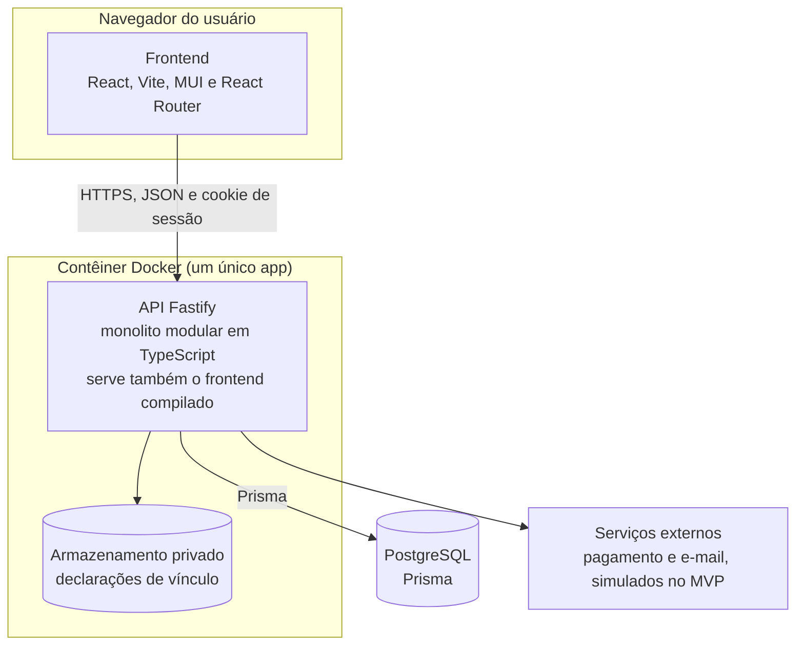
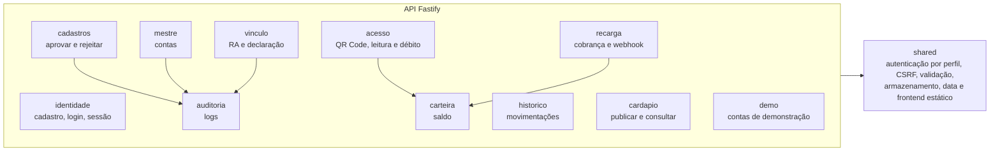
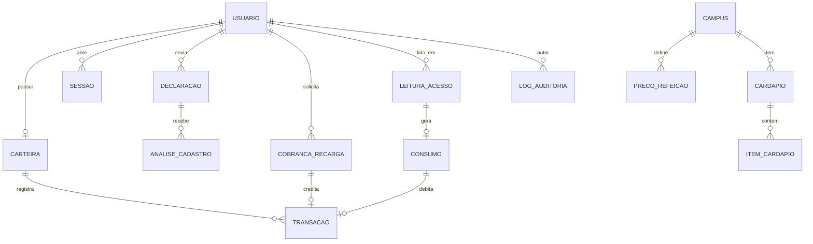
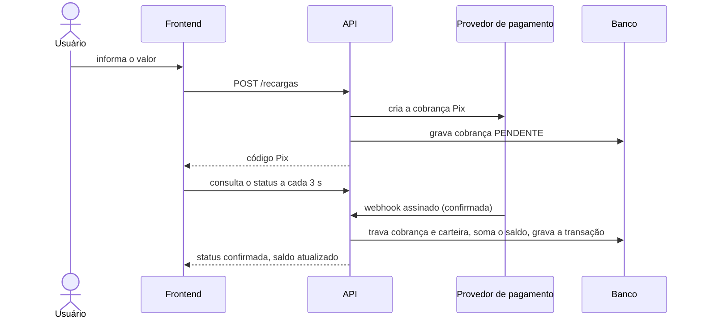
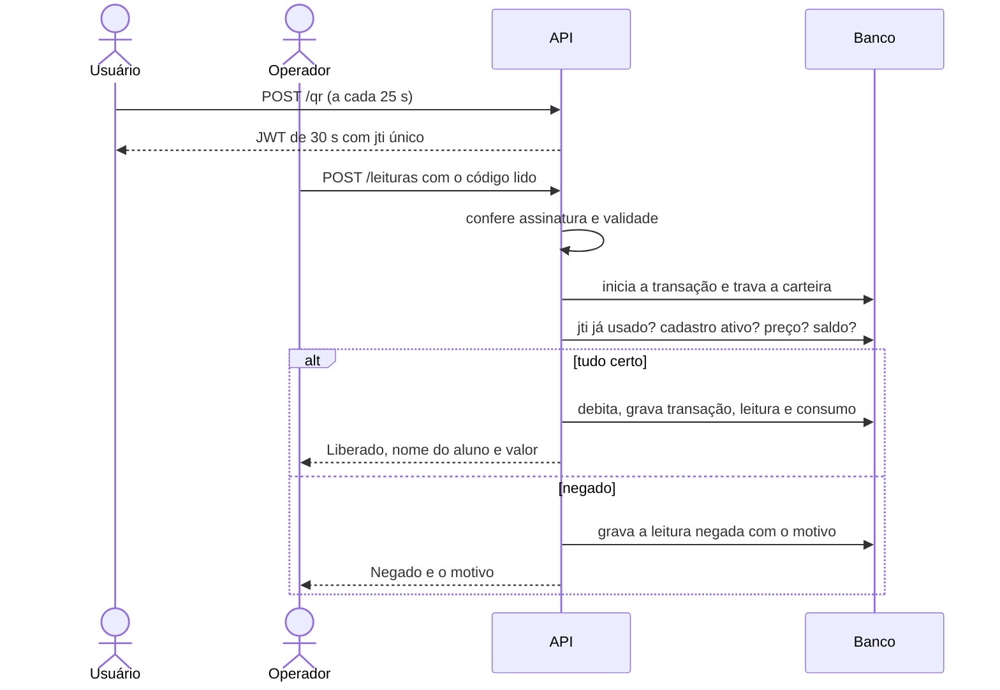
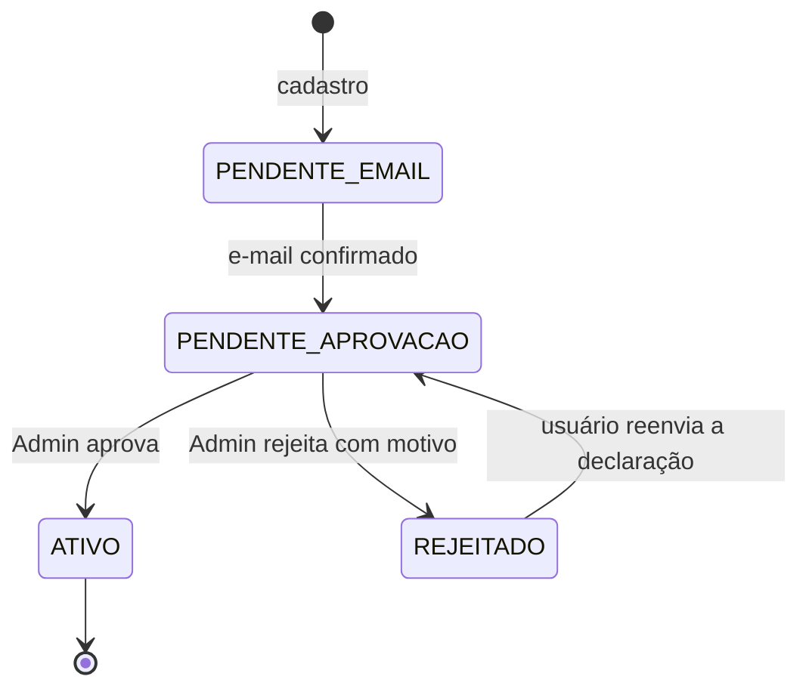
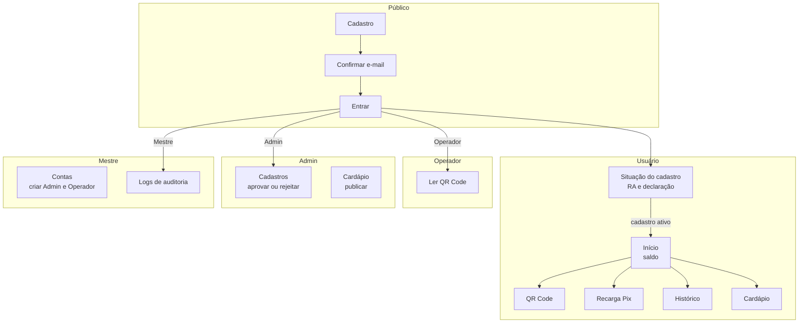

# RU Mine: documento final

**Carteira digital com QR Code para o Restaurante Universitário da UTFPR (câmpus Dois Vizinhos).**
Projeto da disciplina de Arquitetura de Software. Versão do código descrita aqui: tag **`v1.0.1`**.

| | |
| --- | --- |
| **Repositório** | https://github.com/peedrolzz/rumine |
| **Quadro (issues e épicos)** | https://github.com/users/peedrolzz/projects/3 |
| **Execução local** | `docker compose up --build` e abrir http://localhost:8080 (veja a seção 8) |
| **Versão publicada** | Fly.io, apenas no dia da apresentação (veja a seção 9) |
| **Documentação de apoio** | `documentos/` (Semanas 0 a 3 e padrão de UX), `README.md`, `CONTRIBUTING.md`, `APRESENTACAO.md` |

## Sumário
1. [Objetivo do sistema](#1-objetivo-do-sistema)
2. [Escopo do MVP](#2-escopo-do-mvp)
3. [Regras de negócio](#3-regras-de-negócio)
4. [Arquitetura](#4-arquitetura)
5. [Telas e fluxo do sistema](#5-telas-e-fluxo-do-sistema)
6. [Qualidade e testes](#6-qualidade-e-testes)
7. [Decisões e desvios em relação à arquitetura proposta](#7-decisões-e-desvios-em-relação-à-arquitetura-proposta)
8. [Como executar e testar](#8-como-executar-e-testar)
9. [Publicação](#9-publicação)
10. [Limitações e trabalhos futuros](#10-limitações-e-trabalhos-futuros)
11. [Organização do repositório](#11-organização-do-repositório)

---

## 1. Objetivo do sistema

O RU Mine é um sistema de informação para a comunidade acadêmica (discentes, docentes e servidores) que **reduz a morosidade e a incerteza no uso do Restaurante Universitário**.

Hoje a entrada no RU depende de filas de pagamento e de controle manual. O sistema troca isso por uma **carteira digital**: o usuário recarrega crédito por pagamento digital, apresenta um **QR Code de curta duração** na entrada e o **valor da refeição é debitado automaticamente** do saldo. O RU ganha um registro confiável de cada acesso, e o usuário acompanha o próprio histórico e consulta o cardápio do dia.

**Atores**

| Ator (perfil) | O que faz no sistema |
| --- | --- |
| **Usuário** (aluno) | Cadastra-se, envia a comprovação de vínculo, recarrega a carteira, mostra o QR Code, consulta histórico e cardápio |
| **Operador** (controlador) | Lê o QR Code do usuário na entrada do RU; o sistema libera ou nega o acesso |
| **Admin** (gerenciador do RU) | Publica o cardápio e aprova ou rejeita os cadastros (comprovação de vínculo) |
| **Mestre** | Cria as contas de Admin e Operador e consulta os logs de auditoria |
| **Serviço de pagamento** (terceiro) | Processa o pagamento da recarga e avisa o sistema (no MVP, uma versão simulada) |

## 2. Escopo do MVP

O MVP cobre os épicos **E1 a E5** (prioridade *Must*). Cada história foi entregue de ponta a ponta (API, interface, banco e testes).

| Épico | Histórias entregues |
| --- | --- |
| **E1 Autenticação e cadastro** | HU-01 (cadastro, confirmação de e-mail, login e sessão), HU-02 (comprovação de vínculo), HU-03 (perfis, Admin e Operador criados pelo Mestre, logs), HU-20 (aprovação ou rejeição de cadastros pelo Admin) |
| **E2 Carteira** | HU-04 (saldo), HU-05 (recarga por Pix com provedor simulado) |
| **E3 Acesso** | HU-06 (QR Code), HU-07 (leitura pelo Operador), HU-08 (débito atômico da refeição) |
| **E4 Histórico** | HU-09 (histórico de recargas, refeições e estornos) |
| **E5 Cardápio** | HU-11 (Admin publica o cardápio), HU-12 (usuário consulta) |

**Fora do MVP:** histórico geral do Admin (HU-10), HU-18, HU-21 e HU-22, e os épicos E6 a E8. A seção 10 lista o que ficou como evolução.

## 3. Regras de negócio

### 3.1 Regras definidas na Semana 1 e como estão no sistema

| Código | Regra | Situação no MVP |
| --- | --- | --- |
| RN-01 | O login é integrado ao e-mail institucional | **Parcial.** O cadastro só aceita e-mail `@alunos.utfpr.edu.br` e exige confirmação pelo link enviado ao e-mail. Não há login único (SSO) com a UTFPR; o e-mail é simulado (o link aparece no log do servidor) |
| RN-02 | Cada usuário tem uma única carteira, identificada pelo seu ID | **Atendida.** A carteira é única por usuário (restrição no banco) e nasce, com saldo zero, quando o Admin aprova o cadastro |
| RN-03 | O crédito só vale após a confirmação do pagamento | **Atendida.** A recarga nasce `PENDENTE` e nunca credita; só a confirmação assinada do provedor soma o valor ao saldo |
| RN-04 | Pagamento falho ou recusado não altera o saldo e o usuário vê o motivo | **Atendida.** Recarga recusada ou expirada mostra o motivo e "Seu saldo não foi alterado" |
| RN-05 | O Controlador lê o ID e só libera o acesso se o saldo for suficiente | **Atendida.** A leitura nega com "Saldo insuficiente" se o saldo for menor que o preço |
| RN-06 | A cada acesso liberado, o valor é debitado e registrado no histórico | **Atendida.** O débito, a leitura e o consumo são gravados numa única transação, e o débito aparece no histórico do usuário |
| RN-07 | O usuário consulta o histórico; o Admin consulta o histórico geral | **Parcial.** O usuário consulta (filtros Tudo, Recargas, Consumo e Estornos). O histórico geral do Admin (HU-10) ficou fora do MVP |
| RN-08 | Somente o Admin cadastra controladores e cria o cardápio | **Alterada.** Só o Admin cria o cardápio. Os controladores (Operador) e os Admins são criados pelo **Mestre**, perfil acrescentado para separar a administração de contas da gestão do RU |
| RN-09 | O fluxo do RU é calculado a partir das leituras | **Parcial.** Todas as leituras (liberadas e negadas) ficam registradas em `leitura_acesso`; o cálculo e a tela de fluxo não foram feitos |
| RN-10 | O valor da refeição pode variar conforme o perfil | **Parcial.** O preço é guardado por câmpus e categoria (estudante, servidor, visitante) e o aluno PAE é isento. No MVP só existe o preço do estudante (R$ 3,50, valor de exemplo do seed) |
| RN-11 | Quem não usa o app mantém o acesso por cartão ou crachá físico | **Fora do MVP** |
| RN-12 | Dados pessoais e financeiros seguem a LGPD, com acesso restrito ao necessário | **Parcial.** Veja a seção 4.6 (medidas aplicadas). O prazo de retenção das declarações não foi definido |

### 3.2 Regras implementadas no sistema (detalhamento)

**Cadastro e identidade**
- Só e-mail do domínio de discentes (`@alunos.utfpr.edu.br`) pode se cadastrar. A senha exige no mínimo 8 caracteres, um número e um caractere especial, e é guardada com **Argon2id**.
- O e-mail precisa ser confirmado (o link só vale ao tocar no botão **Confirmar e-mail**).
- A sessão fica em cookie `HttpOnly` (e `Secure` em produção), com validade de **45 dias**; o hash do token fica no banco.
- Existe limitador de tentativas de login.

**Ciclo de vida do cadastro**
- Estados: `PENDENTE_EMAIL`, `PENDENTE_APROVACAO`, `ATIVO` e `REJEITADO` (além de `DESATIVADO`).
- Para ser aprovado, o usuário envia o **RA** e a **declaração de matrícula** (PDF, JPG ou PNG de até **5 MB**; o tipo é validado pelo conteúdo real do arquivo, não pela extensão).
- O Admin aprova ou rejeita; a rejeição exige **motivo** (5 a 300 caracteres) e o usuário pode reenviar. Cada decisão e cada abertura de declaração vão para o log de auditoria.
- Só conta **ativa** tem carteira, recarrega e recebe QR Code. Conta em análise ou rejeitada recebe 403 com a explicação.

**Recarga**
- Valor entre **R$ 5,00 e R$ 200,00**; prazo de **30 minutos** para pagar; no máximo **3 recargas pendentes** por usuário.
- O provedor avisa por webhook **assinado (HMAC-SHA256)**; aviso sem assinatura válida é recusado.
- O crédito é **idempotente**: o mesmo aviso repetido (inclusive ao mesmo tempo) credita uma única vez. Aviso com valor diferente do cobrado não credita nada.

**QR Code e acesso**
- O QR é um **JWT assinado** com validade de **30 segundos**, com identificador único (`jti`). **Nunca contém o RA**, e-mail ou nome. A tela o renova sozinha 5 segundos antes de vencer.
- Cada QR vale **uma única leitura**: o `jti` é gravado com restrição única no banco. Print de um código usado ou vencido é negado.
- Resultados possíveis da leitura: **liberado**, saldo insuficiente, código inválido, expirado, já usado e cadastro inativo.
- A resposta ao Operador traz só o **nome** do aluno (nunca RA nem saldo).

**Carteira e débito**
- O saldo é guardado em **centavos inteiros** e **nunca fica negativo** (restrição `CHECK` no banco).
- O débito roda em uma única transação que **trava a carteira** (`SELECT ... FOR UPDATE`): duas leituras ao mesmo tempo não gastam o mesmo saldo duas vezes.
- Aluno **PAE** é liberado sem débito (consumo de R$ 0,00).
- Sem preço configurado, a leitura responde erro e **não consome** o código.

**Cardápio**
- Um cardápio por data, com oito categorias fixas (proteína animal, proteína vegetariana, carboidratos 1 a 3, saladas 1 e 2, sobremesa e suco). Só o Admin publica; ao salvar uma data que já tem cardápio, ele é substituído.

**Perfis**
- Quatro perfis (Usuário, Operador, Admin, Mestre). **Quem barra de verdade é o backend**; o frontend só esconde menus. Uma matriz de testes cruza cada rota com cada perfil.

## 4. Arquitetura

Estilo: **monolito modular** em TypeScript, em contêiner Docker, com PostgreSQL. Os diagramas abaixo usam a notação C4 (contexto, contêineres e componentes) e estão em Mermaid (o GitHub os desenha direto).

### 4.1 C4 nível 1: contexto



### 4.2 C4 nível 2: contêineres



Pontos de projeto:
- **App único:** a API serve o frontend na **mesma origem**, o que mantém o cookie de sessão (`SameSite=Lax`) funcionando sem CORS.
- **Integrações atrás de interfaces:** pagamento (`GatewayPagamento`), e-mail (`ServicoEmail`) e arquivos (`Armazenamento`) têm versão simulada ou local; trocar por um serviço real não muda o resto do sistema.

### 4.3 C4 nível 3: componentes (módulos da API)



Cada módulo tem **rotas, serviço e repositório**, montados por funções de fábrica (injeção de dependências manual). Isso permite testar o serviço com um repositório em memória e o repositório real contra o banco.

### 4.4 Modelo de dados (resumo)



Valores monetários são **centavos inteiros**. As restrições que garantem as regras estão no banco: saldo `>= 0`, uma carteira por usuário, `token_jti` único (uso único do QR) e um consumo por leitura.

### 4.5 Fluxos principais

**Recarga (crédito só após a confirmação)**


**Acesso: QR Code, leitura e débito**


**Ciclo de vida do cadastro**


### 4.6 Segurança e privacidade (RN-12)
- **Senha:** Argon2id. **Sessão:** cookie `HttpOnly`, `Secure` em produção, hash do token no banco.
- **CSRF:** requisições que alteram dados só valem se o `Origin` for o do frontend.
- **QR Code:** JWT HS256 de 30 s, uso único, sem dados pessoais; a verificação recusa `alg: none`, outro algoritmo e outro segredo.
- **Declarações de vínculo:** guardadas em armazenamento **privado**, nunca servidas diretamente; só o Admin as abre, por rota autenticada, e cada abertura vai para o log.
- **Auditoria:** criação de contas, aprovações, rejeições e aberturas de declaração são registradas na mesma transação da ação.
- **Perfis:** autorização no backend por perfil, coberta por uma matriz de testes.
- **Segredos** (`DATABASE_URL`, `PAGAMENTO_WEBHOOK_SEGREDO`, `QR_SEGREDO`) ficam fora do Git; em produção o servidor não sobe sem eles.

### 4.7 Tecnologias

| Camada | Escolha |
| --- | --- |
| Linguagem | TypeScript (Node.js 26) |
| Backend | Fastify, Zod (validação), Prisma 7 |
| Banco | PostgreSQL 16 |
| Frontend | React 19, Vite, MUI 9, React Router 7 |
| QR Code | `qrcode.react` (gera) e `@yudiel/react-qr-scanner` (lê pela câmera); JWT com `jose` |
| Testes | Vitest (backend e frontend) e Testing Library |
| Contêiner e CI | Docker e GitHub Actions |

## 5. Telas e fluxo do sistema

O app é pensado para **celular** (coluna única de até 480 px, botões de no mínimo 44 px). Toda tela trata os estados de **carregando, vazio, erro e sucesso**, com mensagens em português. Valores aparecem como `R$ 1.234,50` e datas como `dd/mm/aaaa`. O menu inferior muda conforme o perfil.

### 5.1 Mapa de navegação



### 5.2 Fluxo do Usuário (aluno)

1. **Cadastro** (`/cadastro`): nome, e-mail `@alunos.utfpr.edu.br` e senha. Cada campo é validado e a mensagem diz qual regra da senha não foi cumprida.
2. **Confirmar e-mail** (`/confirmar-email`): abre pelo link enviado (no MVP, o link aparece nos logs do servidor) e confirma ao tocar no botão.
3. **Entrar** (`/entrar`): e-mail e senha. Sessão expirada leva de volta a esta tela com um aviso.
4. **Situação do cadastro** (`/status-cadastro`): o primeiro acesso pede o **RA** e a **declaração de matrícula** (PDF, JPG ou PNG de até 5 MB). Depois do envio aparece **"Cadastro em análise"**. Se o Admin rejeitar, a tela mostra o **motivo** e permite **reenviar**.
5. **Início** (`/`): mostra o **saldo** em destaque, o botão **Mostrar QR Code**, o botão **Recarregar** e "Atualizar saldo" (o saldo também atualiza ao voltar para o app).
6. **QR Code** (`/qr`): mostra o QR grande, a contagem "Expira em N s" e se **renova sozinho** 5 s antes de vencer. Se a renovação falhar, o código atual continua até vencer; depois aparece **"QR Code expirado"** e **"Gerar de novo"**. Conta em análise vê o motivo, sem QR.
7. **Recarga** (`/recarga`): o usuário informa o valor (atalhos de R$ 10, 20 e 50; limites visíveis), recebe o **código Pix** com **Copiar código** e a tela acompanha o pagamento. Resultados: **confirmada** (saldo atualizado), **recusada** (motivo e "Seu saldo não foi alterado") ou **prazo encerrado**. Na demonstração, os botões **Simular pagamento aprovado/recusado** substituem o banco.
8. **Histórico** (`/historico`): lista recargas, refeições e estornos, com abas **Tudo, Recargas, Consumo e Estornos** e paginação ("Carregar mais"). Refeições isentas (PAE) aparecem sem valor.
9. **Cardápio** (`/cardapio`): cardápio de uma data, com dia anterior, próximo dia e "Ir para a data"; mostra mensagem clara quando a data não tem cardápio.
10. **Perfil** (`/perfil`): nome, e-mail, perfil e **Sair**.

### 5.3 Fluxo do Operador

- **Ler QR Code** (`/operador/leitura`): abre a câmera traseira e lê o QR. Mostra **"Conferindo o código..."** e depois o resultado em **tela cheia**: **verde "Liberado"** com o nome do aluno e o valor cobrado (ou "Refeição isenta (PAE)"), ou **vermelho "Negado"** com o motivo: saldo insuficiente, QR expirado, QR já utilizado, QR inválido ou cadastro inativo. A tela **volta a ler sozinha em 5 s** (ou por "Ler próximo"), para atender a fila. Se a câmera for negada ou não existir, a tela explica e oferece **colar o código manualmente**.

### 5.4 Fluxo do Admin

- **Cadastros** (`/admin/cadastros`): fila de cadastros aguardando análise, com RA, data de envio e o botão **Ver declaração**. **Aprovar** pede confirmação (e cria a carteira do aluno); **Rejeitar** pede o **motivo**. Fila vazia mostra "Nenhum cadastro aguardando análise".
- **Cardápio** (`/admin/cardapio`): formulário com as oito categorias para uma data. Informa se já existe cardápio ("Ao salvar, ele será substituído") e confirma com "Cardápio salvo! Os usuários já podem vê-lo".

### 5.5 Fluxo do Mestre

- **Contas** (`/mestre/contas`): cria **Admin** ou **Operador** (nome, e-mail, senha temporária); a conta nasce ativa.
- **Logs** (`/mestre/logs`): lista de auditoria (quem fez o quê e quando), com "Carregar mais".

### 5.6 Fluxo ponta a ponta de uma refeição

1. O **Admin** aprova o cadastro do aluno (a carteira nasce com saldo zero).
2. O **aluno** recarrega (Pix simulado) e vê o saldo subir.
3. Na entrada do RU, o aluno abre **Mostrar QR Code** e o **Operador** lê pela câmera.
4. O sistema confere o QR, trava a carteira, debita o valor e responde **Liberado**.
5. O aluno vê a refeição no **Histórico** e o saldo atualizado no **Início**.
6. Ler o mesmo código de novo é **negado**.

## 6. Qualidade e testes

- **Mais de 750 testes automatizados no backend e mais de 620 no frontend** (Vitest), rodando na **CI** a cada pull request (tipos, lint, testes, build do frontend e build da imagem Docker).
- **Matriz de acesso por perfil:** cruza cada rota com cada perfil; um teste falha se uma rota nova não estiver na matriz.
- **Teste de mutação manual:** em cada história, proteções críticas foram removidas de propósito (por exemplo assinatura do webhook, limites, dono do recurso, expiração do QR, envio duplo) para provar que os testes as pegam.
- **Verificação contra o PostgreSQL real**, incluindo **concorrência**: 25 confirmações simultâneas do mesmo pagamento creditaram uma vez; 20 leituras simultâneas do mesmo QR liberaram uma vez; 10 QR diferentes ao mesmo tempo com saldo para um só liberaram um. Essas provas foram feitas manualmente (a CI não sobe PostgreSQL).
- **Fluxo de trabalho:** uma branch por história, commits no padrão `tipo(escopo): descrição`, pull requests revisados com "Como testar" e "Como foi verificado".
- **Pendente:** conferência visual em 360 px e leitura do QR com a câmera de um celular real (feitas pela equipe na fase de teste manual).

## 7. Decisões e desvios em relação à arquitetura proposta

O núcleo foi mantido: monolito modular (ADR-001), Fastify com módulos manuais (ADR-002), PostgreSQL com Prisma (ADR-004) e a autenticação e o QR do ADR-005. Os desvios foram conscientes e estão abaixo.

| Item | Proposto | Realizado | Motivo |
| --- | --- | --- | --- |
| Pagamento (ADR-006) | Sandbox do Mercado Pago | Provedor **simulado** (webhook assinado e crédito idempotente já implementados) | Decisão do P.O.: o sandbox exige credenciais e URL pública; o ADR já previa o simulado como plano B |
| Arquivos (ADR-008) | Supabase Storage | **Disco**, atrás da interface `Armazenamento` | Simplicidade no MVP |
| Limite do upload (ADR-008) | 2 MB | **5 MB** | Decisão do P.O. |
| E-mail (ADR-008) | Resend | **Simulado** (link no log) | Resend exige verificar domínio |
| Banco (ADR-009) | Fly Postgres | **Neon** (PostgreSQL gratuito) na publicação | Restrição de custo; o estilo não muda |
| Deploy (ADR-009) | Fly.io sempre no ar | Fly.io **só na apresentação**; no dia a dia, `docker compose` | O Fly não tem plano grátis |
| Forma do deploy | Contêiner Docker | Contêiner **único** (API + frontend na mesma origem) | Cookie de sessão sem CORS |
| Integração UTFPR (ADR-007) | Adaptador simulado | **Não implementado** (existe o campo `envio_utfpr`) | Fora do MVP |
| Testes ponta a ponta | Playwright | **Não feito** | Tempo |
| PWA (ADR-003) | PWA | **Não instalável** (sem manifest nem service worker); app web responsivo | Tempo |
| Perfis (RN-08) | Admin cadastra controladores | Perfil **Mestre** cria Admin e Operador | Separar a gestão de contas da gestão do RU |

## 8. Como executar e testar

**Sem instalar Node** (recomendado para avaliar):
```bash
git clone https://github.com/peedrolzz/rumine.git
cd rumine
docker compose up --build
```
Quando aparecer `Server listening`, abra **http://localhost:8080**. O app aplica as migrações e cria as contas de demonstração. Para apagar o banco local: `docker compose down -v`.

**Contas de demonstração** (senha `Demo@2026`):

| Perfil | E-mail | O que mostra |
| --- | --- | --- |
| Usuário | `aluno.demo@alunos.utfpr.edu.br` | Cadastro aprovado, saldo de R$ 53,00 e histórico |
| Usuário | `pendente.demo@alunos.utfpr.edu.br` | Cadastro em análise (declaração enviada) |
| Admin | `admin.demo@rumine.demo` | Cardápio e aprovação de cadastros |
| Operador | `operador.demo@rumine.demo` | Leitura do QR Code |
| Mestre | `mestre.demo@rumine.demo` | Criar contas e consultar logs |

**Roteiro de 5 minutos:** entre como aluno e veja o saldo; faça uma **Recarga** de R$ 20,00 e clique em **Simular pagamento aprovado**; abra **Mostrar QR Code**. Em uma janela anônima, entre como Operador, abra **Ler QR** e leia o código (câmera, ou colando o código): aparece **Liberado** e o saldo cai R$ 3,50. Leia de novo: **Negado**. Entre como Admin, abra **Cadastros**, abra a declaração do aluno em análise e aprove. Entre como Mestre e veja os **Logs**.

Para desenvolver (backend e frontend à parte), veja o `README.md` e o `CONTRIBUTING.md`.

## 9. Publicação

O app é publicado no **Fly.io** (contêiner Docker, região GRU) com banco no Neon. Como o Fly não tem plano grátis, o app existe **só no dia da apresentação**: sobe pouco antes e é apagado logo depois. O passo a passo, com checklist e solução de erros, está em `APRESENTACAO.md`. As migrações são aplicadas automaticamente a cada deploy.

## 10. Limitações e trabalhos futuros

- Provedor de pagamento real (Mercado Pago) e envio de e-mail real (Resend).
- Armazenamento das declarações em nuvem, e definição do prazo de retenção (LGPD).
- PWA instalável e funcionamento offline parcial; testes ponta a ponta.
- Histórico geral e fluxo do RU para o Admin (HU-10, RN-09); HU-18, HU-21 e HU-22.
- Acesso por cartão ou crachá físico (RN-11); critério do SIAPE e domínio de e-mail de docentes na HU-02.
- Tela de troca de senha e e-mail ao aluno quando o cadastro é aprovado ou rejeitado.
- O limitador de login é em memória (funciona com uma instância); a CI não sobe PostgreSQL, então as provas de concorrência são manuais.
- O preço da refeição (R$ 3,50) é um valor de exemplo; falta uma tela para o Admin gerir preços.
- `/historico` e `/cardapios` não exigem cadastro ativo.

## 11. Organização do repositório

```
rumine/
├── backend/        API Fastify (src/modules/*), Prisma (prisma/), scripts
├── frontend/       React + Vite (src/paginas, src/api, src/auth)
├── documentos/     Semanas 0 a 3 e padrão de UX (PDF)
├── docs/           este documento
├── Dockerfile, docker-compose.yml, fly.toml
├── README.md, CONTRIBUTING.md, APRESENTACAO.md
└── .github/workflows/ci.yml
```

- **Gestão:** cada história é um issue no quadro; o trabalho é feito em branches `feat/hu-NN-descricao` e entra por pull request (Squash and merge) com `Refs #N`; o cartão vai para "pendente de teste" e só depois é concluído.
- **Marcos:** tag `v0.1.0` (projeto base) e `v1.0.0` e `v1.0.1` (MVP, ainda sem o teste manual completo). As tags de épico (`epico-eN-nome`) são criadas pelo P.O. depois do teste.
- **Integração contínua:** GitHub Actions com backend (tipos e testes), frontend (lint, testes e build) e build da imagem Docker.
